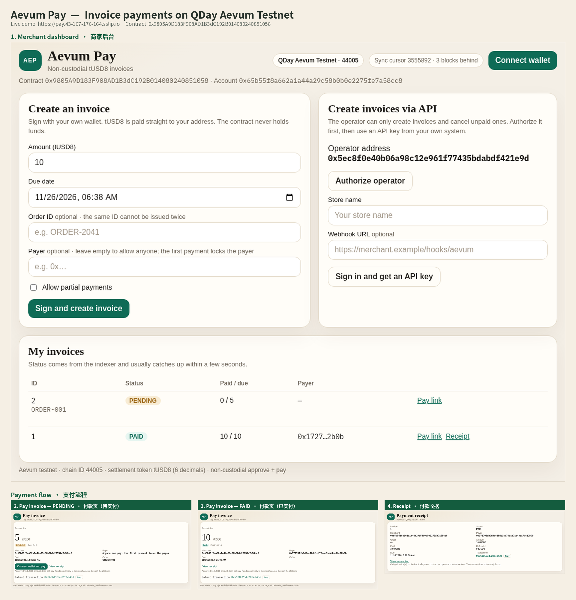
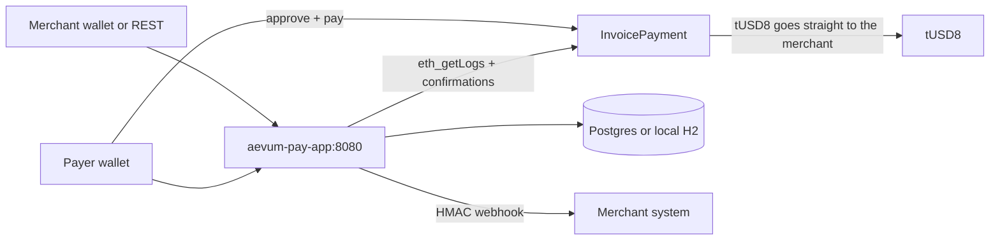

# Aevum Pay

Non-custodial invoice payments on [QDay Aevum Testnet](https://qday.io/builder-challenge), submitted to the **Invoice Payments** track of [Aevum Builder Challenge #1](https://dorahacks.io/hackathon/qday).

QDay Aevum 测试网上的非托管发票支付，参加 [Aevum Builder Challenge #1](https://dorahacks.io/hackathon/qday) 的 **Invoice Payments**（发票支付）赛道。

[Live demo / 在线演示](https://pay.43-167-176-164.sslip.io) · [Contract / 合约](https://explorer-test.qday.info/address/0x9805A9D183F908AD1B3dC192B014080240851058) · [Hackathon / 比赛页](https://dorahacks.io/hackathon/qday)

---

## English

A merchant connects an injected wallet (OKX Wallet or any EIP-1193 provider), creates an on-chain invoice, and shares `/pay/{id}`. The payer approves **tUSD8** for that amount only, then calls `pay`. Tokens move from the payer to the merchant inside that transaction. The contract does not hold balances, and the platform never takes custody of the funds.

A Java 21 / Spring Boot service polls `eth_getLogs` with confirmations and a persisted block cursor (including reorg rollback), then delivers HMAC-signed webhooks with exponential retry. The same process serves the static UI on port **8080**.

### Live deployment

| Item | Value |
| --- | --- |
| Demo | https://pay.43-167-176-164.sslip.io |
| Network | QDay Aevum Testnet |
| Chain ID | 44005 (`0xabe5`) |
| InvoicePayment | [`0x9805A9D183F908AD1B3dC192B014080240851058`](https://explorer-test.qday.info/address/0x9805A9D183F908AD1B3dC192B014080240851058) |
| Start block | 3303804 |
| tUSD8 (6 decimals) | [`0x456569838f1d43009A91ebA4263147Afd7233483`](https://explorer-test.qday.info/address/0x456569838f1d43009A91ebA4263147Afd7233483) |
| RPC | https://rpc-test.qday.info |
| Explorer | https://explorer-test.qday.info |
| Gas token | tQDAY |
| Faucet | https://faucet.qday.info/en |

Try the live paid invoice at [/pay/1](https://pay.43-167-176-164.sslip.io/pay/1) and its [receipt](https://pay.43-167-176-164.sslip.io/receipt/1). A pending demo invoice is at [/pay/2](https://pay.43-167-176-164.sslip.io/pay/2). Paying a pending invoice spends testnet tUSD8 and tQDAY; use the faucet, not mainnet funds.

### Screenshots



| Screen | Image |
| --- | --- |
| Merchant dashboard | [dashboard.png](docs/screenshots/dashboard.png) |
| Create invoice | [create-invoice.png](docs/screenshots/create-invoice.png) |
| Pay page (pending) | [pay-pending.png](docs/screenshots/pay-pending.png) |
| Pay page (paid) | [pay-paid.png](docs/screenshots/pay-paid.png) |
| Receipt | [receipt-paid.png](docs/screenshots/receipt-paid.png) |

The invoice rows in the dashboard screenshot are real testnet invoices, rendered from the public API (`GET /api/v1/public/invoices?merchant=…`) because a headless browser has no wallet. No new on-chain transactions were sent to capture these images.

### Architecture



The chain is the source of truth. The database is a read model and can be rebuilt from `START_BLOCK`. A longer note is in [docs/architecture.md](docs/architecture.md).

| Part | Directory | Role |
| --- | --- | --- |
| Contract | `contracts/` | Foundry, Solidity 0.8.24, `evm_version = shanghai` |
| Backend | `backend/` | Java 21, Spring Boot 3.5, web3j 6, JPA |
| UI | `frontend/` | Static HTML + ethers.js v6, served by the backend |
| Compose | `docker-compose.yml` | `aevum-pay-app` + a small Postgres |

Invoice storage states are Pending, PartiallyPaid, Paid, Cancelled, and Refunded. Expiry is not written to storage: `statusOf()` returns Expired when `block.timestamp > dueAt`. The contract also supports partial payments, open invoices (the first payment locks the payer), `orderRef` de-duplication, merchant refunds, a fee capped at 1%, and pause (refunds still work).

Safety: Checks-Effects-Interactions, `ReentrancyGuard`, `SafeERC20`. Tests include a reentrant token and amount fuzzing. The contract rejects bare tQDAY transfers. There is no admin withdraw function, and the settlement token is fixed at construction.

### Local run

You need Foundry, JDK 21, and Maven. Dependencies download on the first run.

```bash
bash scripts/bootstrap-contracts.sh   # forge install; lib/ is not committed
bash scripts/dev-anvil.sh
```

Then open http://127.0.0.1:8080/ . The script prints three **Anvil public dev accounts** (not secrets, and not for Aevum):

- Merchant: already funded with mock tUSD8, used to create invoices and refund
- Payer: already funded with mock tUSD8, used to pay
- Deployer: already `setOperator` by the merchant; the backend uses it to create invoices

Import the matching private keys into MetaMask or OKX Wallet. When the page sees the wrong chain, it adds chainId `0x7a69` with RPC `http://127.0.0.1:8545`. Press Ctrl-C to stop Anvil and the backend.

### Tests

Headless create → approve → pay → indexer sees `Paid` → signed webhook (prints `e2e passed` on success):

```bash
bash scripts/e2e.sh
```

Or run the suites separately:

```bash
cd contracts && forge test
cd backend && mvn test
```

### Server deploy

On the 2 vCPU / 2 GB Tencent Cloud host, Caddy already owns ports 80/443 and the Docker network `private-room-net`. This project's Compose file **does not bind 80/443**.

| Container | Role |
| --- | --- |
| `aevum-pay-app` | UI + API, container port **8080**. Caddy uses `reverse_proxy aevum-pay-app:8080` |
| `aevum-pay-db` | Postgres 16, small buffers, not published to the host |

Step-by-step commands, environment variables, and keystore mounts are in [scripts/deploy-aevum.md](scripts/deploy-aevum.md). Copy `.env.example` to `.env` and keep private keys only on the server. Do not commit `.env` or a private key. This repository does not broadcast the contract for you; the live testnet address above was deployed separately.

JVM heap is about `-Xmx320m`. The app container is capped at 480 MB, the database at 192 MB.

---

## 中文

商家连接注入式钱包（OKX Wallet 或任意 EIP-1193 钱包），在链上开一张发票，然后分享 `/pay/{id}`。付款人只授权这一笔金额的 **tUSD8**，再调用 `pay`。代币在同一笔交易里从付款人转到商家。合约不留存余额，平台也保管不到这笔钱。

Java 21 / Spring Boot 服务按确认数轮询 `eth_getLogs`，游标持久化，并处理重组回退，然后用带 HMAC 签名、指数退避的 webhook 通知商家。同一个进程在 **8080** 端口提供静态页面。

### 已上线的地址

见上方英文表格。在线演示：https://pay.43-167-176-164.sslip.io 。合约浏览器：[InvoicePayment](https://explorer-test.qday.info/address/0x9805A9D183F908AD1B3dC192B014080240851058)。可直接打开已支付的 [/pay/1](https://pay.43-167-176-164.sslip.io/pay/1) 和 [收据](https://pay.43-167-176-164.sslip.io/receipt/1)，以及待支付的 [/pay/2](https://pay.43-167-176-164.sslip.io/pay/2)。支付待支付发票会花掉测试网的 tUSD8 和 tQDAY，请用水龙头领取，不要用主网资金。

### 截图

总览图和各页面截图见 [docs/screenshots](docs/screenshots) 以及上面的英文截图表。后台列表里的发票是测试网上已有的真实发票，通过公开 API 渲染（无头浏览器没有钱包），截图过程中没有发送新的链上交易。

### 架构

见上方 mermaid 图和 [docs/architecture.md](docs/architecture.md)。链是唯一真相，数据库是读模型，丢了可以从 `START_BLOCK` 重扫。

发票在存储里的状态是 Pending、PartiallyPaid、Paid、Cancelled、Refunded。过期不写存储：`statusOf()` 看到 `block.timestamp > dueAt` 就返回 Expired。合约还支持部分付款、开放发票（第一笔锁定付款人）、`orderRef` 去重、商家退款、不超过 1% 的手续费，以及暂停（暂停时仍可退款）。

安全上用了 Checks-Effects-Interactions、`ReentrancyGuard`、`SafeERC20`。测试包含重入代币和金额模糊测试。合约拒绝直接转入的 tQDAY。没有管理员提款函数，结算币在构造时定死。

### 本地一条命令

需要 Foundry、JDK 21、Maven。依赖第一次会下载。

```bash
bash scripts/bootstrap-contracts.sh   # forge install，lib/ 不进 git
bash scripts/dev-anvil.sh
```

然后打开 http://127.0.0.1:8080/ 。脚本会打印三个 **Anvil 公开开发账户**（不是机密，也不能用于 Aevum）：商家、付款人、部署者（已被商家 `setOperator`，后端用它代开票）。在 MetaMask / OKX 里导入对应私钥。页面发现链不对时会添加 chainId `0x7a69`，RPC 是 `http://127.0.0.1:8545`。Ctrl-C 停下 Anvil 和后端。

### 测试

```bash
bash scripts/e2e.sh          # 无界面跑通 开票 → 授权 → 支付 → 已支付 → 带签名 webhook
cd contracts && forge test
cd backend && mvn test
```

### 服务器部署

腾讯云那台 2 vCPU / 2 GB 的机器上，Caddy 已经占着 80/443 和网络 `private-room-net`。本项目的 Compose **不绑定 80/443**。逐步命令、环境变量和 keystore 挂载方式在 [scripts/deploy-aevum.md](scripts/deploy-aevum.md)。复制 `.env.example` 为 `.env`，私钥只放在服务器上，不要提交。本仓库不会替你向 Aevum 广播合约；上面的测试网地址是另行部署的。

---

## HTTP API

Merchant endpoints require `X-Api-Key`. Registration signs the message from `/api/v1/auth/nonce` with `personal_sign`.

商家接口要带 `X-Api-Key`。注册时用钱包对 `/api/v1/auth/nonce` 返回的原文做 `personal_sign`。

| Method | Path | Description / 说明 |
| --- | --- | --- |
| GET | `/api/v1/public/config` | Chain, contract, token, operator address / 链、合约、代币、操作员地址 |
| GET | `/api/v1/public/sync` | Indexer cursor and lag / 索引游标和落后块数 |
| GET | `/api/v1/public/invoices?merchant=0x…` | Public invoice list for a merchant / 某商家的公开发票列表 |
| GET | `/api/v1/public/invoices/{chainId}` | Pay-page payload; overlays `getInvoice` when RPC is up / 支付页数据，能连上 RPC 时用链上结果覆盖 |
| GET | `/api/v1/public/invoices/{chainId}/receipt` | Receipt JSON / 收据 JSON |
| POST | `/api/v1/merchants` | Register; returns a one-time API key and webhook secret / 注册，返回一次性 API Key 和 webhook secret |
| POST | `/api/v1/invoices` | Operator-created invoice. Optional `Idempotency-Key`. Amount is the integer string in tUSD8 base units / 代开票。金额是 tUSD8 最小单位的整数字符串 |
| GET | `/api/v1/invoices` | Current merchant's invoices, filterable by `status`, `from`, `to` / 当前商家的发票 |
| GET | `/api/v1/invoices/export` | CSV |
| POST | `/api/v1/invoices/{localId}/cancel` | Operator cancels an unpaid invoice / 操作员取消未收款发票 |
| POST | `/api/v1/webhooks/{id}/retry` | Re-queue a DEAD or failed webhook / 把失败通知重新排队 |
| GET | `/actuator/health` | Health check / 健康检查 |

Refunds must be signed by the merchant's wallet, so they happen on the page, not through this API. 退款必须商家钱包出钱，所以在页面上签名，不走这个 API。

`orderRef` is `keccak256(UTF-8 order id)`, matching `ethers.keccak256(ethers.toUtf8Bytes(orderId))` in the UI. An empty order id is `bytes32(0)` and is not de-duplicated on chain. 空订单号对应 `bytes32(0)`，链上不去重。

Webhook body / webhook 体例：

```json
{
  "id": "evt_1",
  "type": "invoice.paid",
  "invoiceId": 1,
  "orderId": "ORD-1",
  "amount": "1000000",
  "totalPaid": "1000000",
  "txHash": "0x…",
  "blockNumber": 12
}
```

Verify by concatenating the `t` header value, a `.`, and the raw body, then comparing HMAC-SHA256 with `v1`. Drop the message if the timestamp is too far off, to prevent replay. 校验时把 header 里的 `t` 和原始 body 用 `.` 拼起来做 HMAC-SHA256，再和 `v1` 比较。时间戳偏离太大就丢掉，避免重放。

## Pages / 页面

- `/` merchant dashboard: connect a wallet, create an invoice, copy the pay link, show a QR code, authorize the operator, register for an API key, refund. If the connected address is the contract owner, pause and fee controls are also shown.
  商家后台：连接钱包、开票、复制支付链接、二维码、授权操作员、注册 API、退款。连接地址是合约 owner 时还可以暂停和设置手续费。
- `/pay/{id}` pay page: balance, approve the exact amount, pay, and decode errors (expired, wrong payer, overpay, user rejected the signature).
  付款页：余额、授权本次金额、支付、错误解码。
- `/receipt/{id}` receipt: fields, explorer link, and how to re-check the contract yourself.
  收据：字段、交易链接、如何自己到浏览器核对。

## Environment variables / 环境变量

Names follow `.env.example`. Common ones / 名字以 `.env.example` 为准。常用的一组：

| Variable | Purpose / 作用 |
| --- | --- |
| `AEVUM_RPC_URL` | RPC used by the backend / 后端用的 RPC |
| `AEVUM_PUBLIC_RPC_URL` | RPC used by the browser wallet; empty means the same as above / 浏览器钱包用的 RPC，空则与上面相同 |
| `AEVUM_CHAIN_ID` | 44005; local Anvil scripts set 31337 / 本地 Anvil 脚本会改成 31337 |
| `CONTRACT_ADDRESS` | Deployed InvoicePayment |
| `TUSD8_ADDRESS` | Official tUSD8, or a local mock / 官方 tUSD8，或本地 mock |
| `START_BLOCK` | Indexer start block / 索引起点，填部署区块 |
| `EXPLORER_URL` | Prefix for transaction links / 交易链接前缀 |
| `CHAIN_CONFIRMATIONS` | 2 on testnet, 0 on Anvil / 测试网建议 2，Anvil 用 0 |
| `AEVUM_OPERATOR_PRIVATE_KEY` | Operator key; may be empty, in which case the backend cannot send transactions / 操作员私钥。可空，空则不能代发交易 |
| `AEVUM_OPERATOR_KEYSTORE` | Encrypted keystore path; alternative to the raw key / 加密 keystore 路径，和上面二选一 |
| `AEVUM_OPERATOR_KEYSTORE_PASSWORD` | Keystore password / keystore 口令 |
| `DEPLOYER_PRIVATE_KEY` | Only for `forge script`; the backend does not read it / 只给 `forge script` 用，后端不读 |
| `POSTGRES_PASSWORD` | Required by Compose / Compose 必填 |
| `PUBLIC_BASE_URL` | Used to build pay links, e.g. `https://pay.example.com` / 拼支付链接 |
| `DATABASE_URL` | Defaults to Compose Postgres; local scripts switch to a file-backed H2 / 默认指向 Compose 里的 Postgres。本地脚本改成 H2 文件库 |

## License / 许可证

[MIT](LICENSE).
