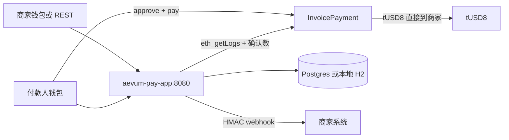

# Aevum Pay

参加 [Aevum Builder Challenge #1](https://qday.io/builder-challenge) 的发票支付赛道。投稿页在 [DoraHacks](https://dorahacks.io/hackathon/qday)。

## English summary

Aevum Pay is a non-custodial invoice app for QDay Aevum Testnet (chainId **44005**). A merchant connects an injected wallet (OKX Wallet or any EIP-1193 provider), creates an invoice, and shares `/pay/{id}`. The payer approves **tUSD8** (`0x456569838f1d43009A91ebA4263147Afd7233483`, 6 decimals) for that payment only, then calls `pay`. Tokens move from the payer to the merchant inside the contract call. The contract does not hold balances.

A Java 21 / Spring Boot 3 service polls `eth_getLogs` with confirmations and a persisted block cursor, then delivers HMAC-signed webhooks with exponential retry. The same process serves the static UI on port **8080**.

Local demo, one command against Anvil and a mock tUSD8:

```bash
bash scripts/dev-anvil.sh
```

Headless check of create → approve → pay → indexer sees `Paid` → signed webhook:

```bash
bash scripts/e2e.sh
```

Server deploy (Docker, external network `private-room-net`, no host ports 80/443) is in [scripts/deploy-aevum.md](scripts/deploy-aevum.md). Do not commit `.env` or a private key. This repository does not deploy to Aevum; you broadcast the contract yourself.

## 要解决的问题

商家要收一笔测试稳定币，并且能回答三件事：收的是哪张发票、付了多少、链上是否已经确认。付款人要一个链接就能付，不用把钱先打进平台。

Aevum Pay 把发票记在链上。付款和核销是同一笔交易：`approve` 之后 `pay(invoiceId, amount)`，合约用 `transferFrom` 把 tUSD8 从付款人转到商家。平台碰不到钱。

## 架构

| 部分 | 目录 | 作用 |
| --- | --- | --- |
| 合约 | `contracts/` | Foundry，Solidity 0.8.24，`evm_version = shanghai` |
| 后端 | `backend/` | Java 21，Spring Boot 3.5，web3j 6，JPA |
| 页面 | `frontend/` | 静态 HTML + ethers.js v6，由后端一起提供 |
| 编排 | `docker-compose.yml` | `aevum-pay-app` + 小内存 Postgres |

更短的说明在 [docs/architecture.md](docs/architecture.md)。



链是唯一真相。数据库是读模型，丢了可以从 `START_BLOCK` 重扫。

### 发票生命周期

存储状态是 Pending、PartiallyPaid、Paid、Cancelled、Refunded。过期不写存储：`statusOf()` 看到 `block.timestamp > dueAt` 就返回 Expired。部分付款、开放发票（第一笔锁定付款人）、`orderRef` 去重、商家退款、不超过 1% 的手续费、暂停（退款仍可用）都在合约里。

安全上用了 Checks-Effects-Interactions、`ReentrancyGuard`、`SafeERC20`。测试包含重入代币和金额模糊测试。合约拒绝直接转入的 tQDAY。没有管理员提款函数，结算币在构造时定死。

### 后端在做什么

- `POST /api/v1/invoices`：操作员热钱包调用 `createInvoiceFor`。商家要先 `setOperator`。
- 商家也可以不经过 API，用钱包直接 `createInvoice`。索引器看到 `InvoiceCreated` 后照样入库。
- 轮询 `eth_getLogs`，不使用会在重启后丢失的 `eth_newFilter`。游标、确认数、重组回退都落在库里。
- Webhook 出站表。签名头 `X-AevumPay-Signature: t=<unix>,v1=<hmac>`，原文是 `t + "." + body`。失败按 `60,300,1800,7200,43200` 秒重试，然后标记 DEAD。

## 网络

| 项 | 值 |
| --- | --- |
| 网络 | QDay Aevum Testnet |
| Chain ID | 44005（`0xabe5`） |
| RPC | https://rpc-test.qday.info |
| 浏览器 | https://explorer-test.qday.info |
| Gas | tQDAY |
| 结算币 | tUSD8，6 位小数，`0x456569838f1d43009A91ebA4263147Afd7233483` |
| 水龙头 | https://faucet.qday.info/en |

## 本地一条命令

需要 Foundry、JDK 21、Maven。依赖第一次会下载。

```bash
bash scripts/bootstrap-contracts.sh   # forge install，lib/ 不进 git
bash scripts/dev-anvil.sh
```

然后打开 http://127.0.0.1:8080/ 。脚本会打印三个 **Anvil 公开开发账户**（不是机密，也不能用于 Aevum）：

- 商家：已有 mock tUSD8，用来开票和退款
- 付款人：已有 mock tUSD8，用来支付
- 部署者：已经被商家 `setOperator`，后端用它代开票

在 MetaMask / OKX 里导入对应私钥。页面发现链不对时会添加 chainId `0x7a69`，RPC 是 `http://127.0.0.1:8545`。

Ctrl-C 停下 Anvil 和后端。

只想跑自动验收、不看页面：

```bash
bash scripts/e2e.sh
```

它会部署 mock 币和合约，注册商家，API 开票，`approve` + `pay`，等到后端状态变成 `PAID`，并校验 webhook 的 HMAC。成功时打印 `e2e passed`。

分开跑测试：

```bash
cd contracts && forge test
cd backend && mvn test
```

## 服务器部署

腾讯云那台 2 vCPU / 2 GB 的机器上，Caddy 已经占着 80/443 和网络 `private-room-net`。本项目的 Compose **不绑定 80/443**。

| 容器 | 说明 |
| --- | --- |
| `aevum-pay-app` | 页面 + API，容器端口 **8080**。Caddy 写 `reverse_proxy aevum-pay-app:8080` |
| `aevum-pay-db` | Postgres 16，小缓冲池，不对宿主机暴露端口 |

逐步命令、环境变量和 keystore 挂载方式在 [scripts/deploy-aevum.md](scripts/deploy-aevum.md)。复制 `.env.example` 为 `.env`，私钥只放在服务器上。

JVM 大约 `-Xmx320m`。应用容器内存上限 480 MB，数据库 192 MB。

## 环境变量

名字以 `.env.example` 为准。常用的一组：

| 变量 | 作用 |
| --- | --- |
| `AEVUM_RPC_URL` | 后端用的 RPC |
| `AEVUM_PUBLIC_RPC_URL` | 浏览器钱包用的 RPC，空则与上面相同 |
| `AEVUM_CHAIN_ID` | 44005，本地 Anvil 脚本会改成 31337 |
| `CONTRACT_ADDRESS` | 部署出的 InvoicePayment |
| `TUSD8_ADDRESS` | 官方 tUSD8，或本地 mock |
| `START_BLOCK` | 索引起点，填部署区块 |
| `EXPLORER_URL` | 交易链接前缀 |
| `CHAIN_CONFIRMATIONS` | 测试网建议 2，Anvil 用 0 |
| `AEVUM_OPERATOR_PRIVATE_KEY` | 操作员私钥。可空，空则不能代发交易 |
| `AEVUM_OPERATOR_KEYSTORE` | 加密 keystore 路径，和上面二选一 |
| `AEVUM_OPERATOR_KEYSTORE_PASSWORD` | keystore 口令 |
| `DEPLOYER_PRIVATE_KEY` | 只给 `forge script` 用，后端不读 |
| `POSTGRES_PASSWORD` | Compose 必填 |
| `PUBLIC_BASE_URL` | 拼支付链接，例如 `https://pay.example.com` |
| `DATABASE_URL` | 默认指向 Compose 里的 Postgres。本地脚本改成 H2 文件库 |

## HTTP API

商家接口要带 `X-Api-Key`。注册时用钱包对 `/api/v1/auth/nonce` 返回的原文做 `personal_sign`。

| 方法 | 路径 | 说明 |
| --- | --- | --- |
| GET | `/api/v1/public/config` | 链、合约、代币、操作员地址 |
| GET | `/api/v1/public/sync` | 索引游标和落后块数 |
| GET | `/api/v1/public/invoices?merchant=0x…` | 商家后台列表 |
| GET | `/api/v1/public/invoices/{chainId}` | 支付页。能连上 RPC 时用链上 `getInvoice` 覆盖金额和状态 |
| GET | `/api/v1/public/invoices/{chainId}/receipt` | 收据 JSON |
| POST | `/api/v1/merchants` | 注册，返回一次性 API Key 和 webhook secret |
| POST | `/api/v1/invoices` | 代开票。可带 `Idempotency-Key`。金额是 tUSD8 最小单位的整数字符串 |
| GET | `/api/v1/invoices` | 当前商家的发票，可按 `status`、`from`、`to` 过滤 |
| GET | `/api/v1/invoices/export` | CSV |
| POST | `/api/v1/invoices/{localId}/cancel` | 操作员取消未收款发票 |
| POST | `/api/v1/webhooks/{id}/retry` | 把 DEAD 或失败的通知重新排队 |
| GET | `/actuator/health` | 健康检查 |

退款必须商家钱包出钱，所以在页面上签名，不走这个 API。

订单号的 `orderRef` 是 `keccak256(UTF-8 订单号)`，和页面里 `ethers.keccak256(ethers.toUtf8Bytes(orderId))` 一致。空订单号对应 `bytes32(0)`，链上不去重。

Webhook 体例：

```json
{
  "id": "evt_1",
  "type": "invoice.paid",
  "invoiceId": 1,
  "orderId": "ORD-1",
  "amount": "1000000",
  "totalPaid": "1000000",
  "txHash": "0x…",
  "blockNumber": 12
}
```

校验时把 header 里的 `t` 和原始 body 用 `.` 拼起来做 HMAC-SHA256，再和 `v1` 比较。时间戳偏离太大就丢掉，避免重放。

## 页面

- `/` 商家后台：连接钱包、开票、复制支付链接、二维码、授权操作员、注册 API、退款。连接地址是合约 owner 时还可以暂停和设置手续费。
- `/pay/{id}` 付款页：余额、授权本次金额、支付、错误解码（过期、付错人、超额、用户拒绝签名）。
- `/receipt/{id}` 收据：字段、交易链接、如何自己到浏览器核对。

## 还没在这台机器上做的事

- 没有向 Aevum 测试网发送交易，也没有填写真实合约地址。部署步骤在 `scripts/deploy-aevum.md`，由你在自己的钱包上执行。
- 收据是 HTML / JSON，不是 PDF。
- 本环境没有安装 OKX 浏览器插件，所以钱包弹窗这条路径没有在真插件里点过。链上收付、索引和 webhook 由 `scripts/e2e.sh` 用 Anvil 跑通。页面能打开，支付页会显示发票金额和状态。

## 许可证

[MIT](LICENSE)。
