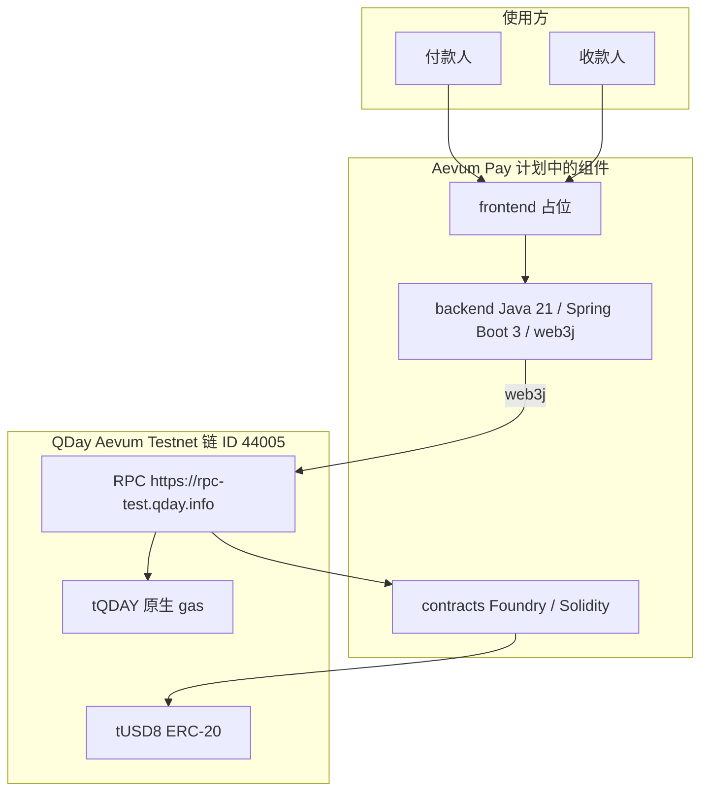
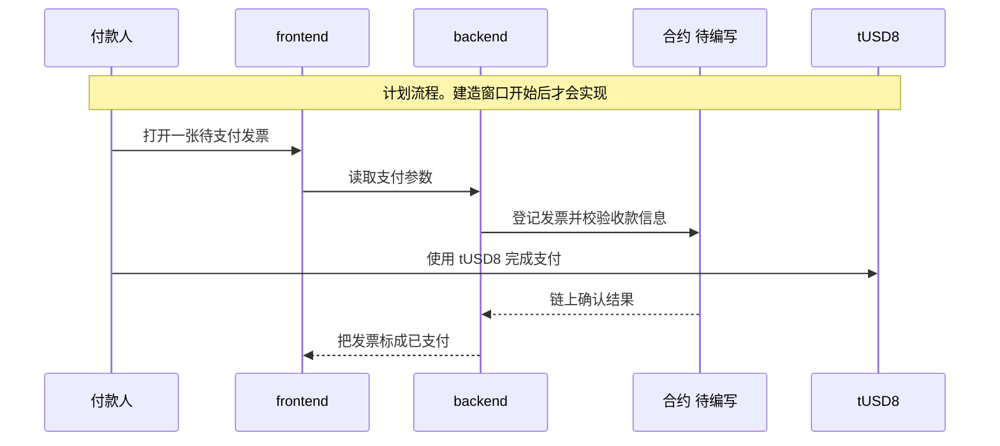

# Aevum Pay

建造窗口开始前的仓库骨架。支付业务、合约和服务实现都还没有写。

## English summary

**Aevum Pay** is a placeholder entry for the [Aevum Builder Challenge #1](https://qday.io/builder-challenge). Submissions are on [DoraHacks](https://dorahacks.io/hackathon/qday). The goal is one complete stablecoin payment flow on **QDay Aevum Testnet**, paid in the test stablecoin **tUSD8**.

The challenge rule is: **all code is written during the build window** (2026-11-16 06:00 UTC through 2026-12-11 08:00 UTC). This repository currently holds documentation and an empty structural skeleton only. There is no payment logic, no Solidity contract, and no service implementation. Files marked TODO are placeholders.

Planned layout, once the build window opens:

- `contracts/` — Solidity with Foundry, to be deployed on Aevum Testnet
- `backend/` — Java 21, Spring Boot 3, Maven, talking to the Aevum RPC with web3j
- `frontend/` — a minimal web UI
- `docker-compose.yml` — run the backend and frontend together
- `docs/` — architecture notes

The track is not final. The likely track is **Invoice Payments**. The network table, faucet steps, run notes, submission checklist, and judging criteria are in the Chinese sections below. RPC URL, chain id, and the signing key are read from environment variables. Do not commit `.env` or any private key.

## 项目是什么

**Aevum Pay** 参加 [Aevum Builder Challenge #1：Stablecoin Payments Hackathon on Aevum](https://qday.io/builder-challenge)。投稿页面在 [DoraHacks](https://dorahacks.io/hackathon/qday)。

每支队伍要在 **QDay Aevum Testnet** 上交付一条完整的稳定币支付流程，测试币是已经部署好的 **tUSD8**。不发行、不承诺任何代币。奖金为 USDT：第一名 800、第二名 500、第三名 200。可个人参加，也可在赛前组成 2 至 4 人的队伍。

赛道还没定。当前倾向 **Invoice Payments（发票支付）**。其他可选赛道包括 Payroll and Vesting、Crowdfunding、Confirmation of Payee、Decentralized Payments、Digital Ownership、Native AI Assistants，或另一种商业支付工具。

### 建造窗口

官方规则写明：**All code is written during the build window.**

| 时间 (UTC) | 事项 |
| --- | --- |
| 2026-11-04 | 预报名开放 |
| 2026-11-16 06:00 | 报名开放，建造期开始，starter kit 发布 |
| 2026-11-16 至 2026-12-11 | 建造期 |
| 2026-12-11 08:00 | 提交截止 |
| 2026-12-12 至 2026-12-14 | 评审 |
| 2026-12-15 06:00 | Demo Day：前五名现场演示并公布获奖者 |

因此，这次提交只包含文档和空骨架。`TODO` 表示留到建造窗口里再写。请不要在窗口开始前往本仓库加入业务逻辑、合约逻辑或服务实现。

## 要解决的问题（占位）

TODO：建造窗口内把问题写具体。

占位描述：在发票支付场景里，付款人要用链上测试稳定币 tUSD8 付清一张发票，收款人要能核对「付的是哪一张发票、这笔支付是否已在 Aevum Testnet 上确认」。本仓库还没有实现创建发票、发起支付、等待确认或展示结果。

## 计划中的架构

技术栈按这个方向预留，建造窗口内再落地：

| 部分 | 目录 | 计划 |
| --- | --- | --- |
| 合约 | `contracts/` | Solidity，Foundry 编译、测试、部署到 Aevum Testnet |
| 后端 | `backend/` | Java 21、Spring Boot 3、Maven；用 web3j 访问 Aevum RPC |
| 前端 | `frontend/` | 最小 Web 界面，供演示付款状态 |
| 编排 | `docker-compose.yml` | 一起跑起后端和前端 |
| 文档 | `docs/` | 问题、架构、核心流程、技术栈 |



下面是倾向中的发票支付主路径。它只说明打算怎么走，对应的合约、接口和页面都还没有。



## 仓库布局

```text
.
├── README.md                 本说明
├── LICENSE                   MIT
├── .gitignore
├── .env.example              只有变量名，没有值
├── docker-compose.yml        编排存根，还不能当 demo
├── contracts/
│   ├── foundry.toml          Foundry 配置，含公开 RPC
│   ├── src/.gitkeep          合约源码目录，目前为空
│   ├── test/.gitkeep
│   └── script/.gitkeep
├── backend/
│   ├── pom.xml               Spring Boot 3 与 web3j 依赖
│   └── src/main/
│       ├── java/io/aevumpay/AevumPayApplication.java
│       └── resources/application.yml
├── frontend/
│   ├── .gitkeep
│   └── README.md
└── docs/
    └── architecture.md       架构笔记存根
```

## 网络配置

以下内容来自挑战页与官方入口，按原样使用。合约和后端都不要把私钥写进源码。

| 项 | 值 |
| --- | --- |
| 网络 | QDay Aevum Testnet |
| Chain ID | 44005（0xABE5） |
| RPC | https://rpc-test.qday.info |
| WebSocket | wss://rpc-test.qday.info |
| 浏览器 | https://explorer-test.qday.info |
| 原生代币 | tQDAY，18 位小数，用于 gas |
| 测试稳定币 | tUSD8，ERC-20，6 位小数 |
| tUSD8 合约 | `0x456569838f1d43009A91ebA4263147Afd7233483` |
| 水龙头 | https://faucet.qday.info/en |

Aevum 与 EVM 兼容。Foundry、Hardhat、Remix、viem 可以按常规方式连接上面的 RPC。后端通过 web3j 访问 RPC，地址来自环境变量 `AEVUM_RPC_URL`。

## 如何领取测试币

水龙头已可用，不需要另外申请额度。只领取测试币。

1. 自己准备一个测试钱包。私钥只放在本机环境变量或密码管理器里，不要发到聊天、issue 或 git。
2. 打开 [水龙头](https://faucet.qday.info/en)，粘贴钱包地址。
3. 领取 **tQDAY**（付 gas）和 **tUSD8**（测试支付）。
4. 在 [测试网浏览器](https://explorer-test.qday.info) 里核对余额。tQDAY 是 18 位小数，tUSD8 是 6 位小数，合约地址见上一节。

## 如何运行（待完成）

TODO：建造窗口内补成「陌生人只看 README 就能跑起来」的步骤，包括合约部署、演示路径和 Docker 镜像。下面只说明骨架今天能做和不能做的事。

### 环境变量

```bash
cp .env.example .env
```

然后在本机的 `.env` 里填值。公开的 RPC、WebSocket 和 Chain ID 用上一节的表。`AEVUM_PRIVATE_KEY` 填测试钱包私钥。`.env` 已被 git 忽略，不要提交它，也不要把它写进历史。

| 变量 | 用途 |
| --- | --- |
| `AEVUM_RPC_URL` | Aevum HTTP RPC |
| `AEVUM_WS_URL` | Aevum WebSocket |
| `AEVUM_CHAIN_ID` | 链 ID，官方值为 44005 |
| `AEVUM_PRIVATE_KEY` | 测试钱包私钥，仅运行时注入 |
| `SERVER_PORT` | 后端端口，默认 8080 |

### 后端

需要 JDK 21 和 Maven。下面的命令只编译并打包空应用，没有支付接口。

```bash
cd backend
mvn -q -DskipTests package
```

本地启动同样没有业务行为。变量未设置时按空字符串读入，进程仍然可以启动。真正签名之前，在本机 `.env` 里填上测试钱包私钥。

```bash
cd backend
set -a
source ../.env
set +a
mvn spring-boot:run
```

### 合约

TODO：`contracts/src` 里还没有 `.sol` 文件。窗口开启并写完合约后，再用 Foundry 编译、测试，并部署到 Chain ID 44005 的官方 Aevum Testnet。`foundry.toml` 只记录了公开 RPC。

### 前端

TODO：`frontend/` 只有说明文件。界面会在建造窗口内补上。

### Docker Compose

根目录的 `docker-compose.yml` 预留了 `backend` 和 `frontend` 两个服务，环境变量从本机传入。两个服务的 `Dockerfile` 都还没有，现在执行 `docker compose up` 会失败。补齐镜像之后，这里才会成为演示入口。

## 提交检查清单

挑战要求的四项交付物：

| 交付物 | 现状 |
| --- | --- |
| 公开、可读的开源仓库 | 仓库已建立；提交前需确认为 Public |
| Aevum 集成证明，例如部署在 Aevum Testnet 上的合约 | TODO |
| 可运行的 demo：界面原型，或能跑起应用的 Docker 镜像 | TODO |
| 文档：问题、架构、核心流程、技术栈 | 本文与 `docs/architecture.md` 为草稿 |

提交前逐项核对：

- [ ] 仓库是公开的，陌生人可以读到源码
- [ ] 当前文件和全部 git 历史里都没有私钥、助记词、`.env` 或其他密钥
- [ ] README 的运行步骤足够让陌生人把项目跑起来
- [ ] 合约部署在官方 Aevum Testnet（Chain ID 44005）
- [ ] 演示视频不登录就能观看
- [ ] 团队成员已经列在下方

前五名会受邀在视频会议上做 3 至 5 分钟现场演示。

### 团队成员

TODO：报名后填写。可以是个人，或 2 至 4 人。

| 姓名 | 角色 | 联系方式 |
| --- | --- | --- |
| （待填写） | （待填写） | （待填写） |

## 评审标准

满分 100，七项标准如下。

| 标准 | 分值 | 本仓库现状 |
| --- | --- | --- |
| 用户体验与展示 User experience and presentation | 15 | 未开始 |
| 清晰、结构完整的演示 Demo | 10 | 未开始 |
| 文档 Documentation | 10 | 已有骨架说明，问题与核心流程仍是占位 |
| 创新与原创 Innovation and originality | 20 | 未开始 |
| 技术质量与平台集成 Technical quality and platform integration | 15 | 只预留了 Foundry、web3j 和测试网配置 |
| 现实效用 Real-world utility | 15 | 问题陈述仍是占位 |
| 安全、信任与控制 Safety, trust and controls | 15 | 私钥只从环境变量读取；控制逻辑尚未编写 |

## 许可证

[MIT](LICENSE)。
