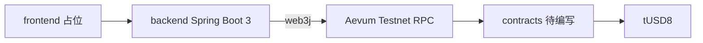

# Aevum Pay 架构笔记（存根）

本文是占位草稿。建造窗口从 **2026-11-16 06:00 UTC** 开始，窗口开启前不写业务逻辑和合约逻辑。网络参数、运行方式和提交清单以仓库根目录的 [README.md](../README.md) 为准。

English: architecture stub only. The payment flow is not implemented yet.

## 问题

TODO：写清发票支付场景里，谁在什么情况下要付 tUSD8，以及怎样算付成功。

占位：付款人需要针对一张发票支付测试稳定币 tUSD8，收款人需要核对发票与 Aevum Testnet 上的确认结果。

## 架构

计划中的组件：

- `contracts/`：Foundry 工程。Solidity 合约部署到 QDay Aevum Testnet（Chain ID 44005）。
- `backend/`：Java 21、Spring Boot 3、Maven。通过 web3j 连接 `AEVUM_RPC_URL`。私钥只来自 `AEVUM_PRIVATE_KEY`。
- `frontend/`：最小 Web 界面，向后端查询并展示支付状态。
- `docker-compose.yml`：同时运行后端和前端。Dockerfile 尚未添加。

## 核心流程

TODO：在建造窗口内按最终赛道补充分步说明、失败分支和链上确认标准。

倾向的主路径是 Invoice Payments：

1. 收款方登记一张待支付发票。
2. 付款方在界面上确认金额与收款信息。
3. 付款方用 tUSD8 完成支付，gas 使用 tQDAY。
4. 后端从 Aevum Testnet 读到确认结果。
5. 界面把该发票显示为已支付。

上述步骤都还没有对应的代码。

## 技术栈

| 层 | 选择 | 现状 |
| --- | --- | --- |
| 合约 | Solidity，Foundry | 只有 `foundry.toml` 和空目录 |
| 后端 | Java 21，Spring Boot 3.5，Maven，web3j 6 | 只有可启动的空应用 |
| 前端 | 待定的最小 Web 界面 | 空目录 |
| 网络 | QDay Aevum Testnet，Chain ID 44005 | 配置写在 README，不写死在 Java 里 |
| 稳定币 | tUSD8，6 位小数 | 使用官方已部署合约，不另发代币 |
| 运行 | Docker Compose | 编排文件是存根 |

## 安全边界

- 不把 `.env`、私钥、助记词或 keystore 放进仓库和 git 历史。
- 只使用水龙头领取的测试币。不部署到主网，不发行代币。
- TODO：建造窗口内补充权限、重放保护、金额校验和收款方确认。
