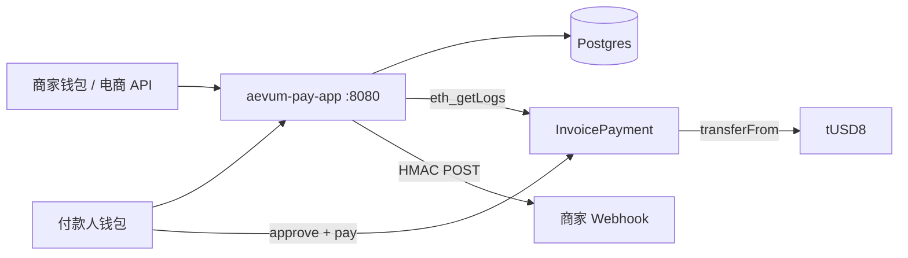

# Aevum Pay 架构

英文摘要：non-custodial tUSD8 invoices. The payer approves the contract and calls `pay`. Tokens move payer → merchant in that transaction. A Java indexer polls `eth_getLogs`, and a webhook outbox delivers HMAC-signed events.

## 组件

- 页面是静态文件，由 Spring Boot 从同一个 8080 端口提供。
- 付款人的私钥只留在浏览器钱包里。后端唯一的密钥是操作员热钱包，用来代开票和取消未收款发票。
- 链是唯一真相。数据库是读模型和 webhook 发件箱，可以从 `START_BLOCK` 重放。

## 发票状态

存储里的状态：`Pending`、`PartiallyPaid`、`Paid`、`Cancelled`、`Refunded`。

`Expired` 不写存储。`statusOf()` 在 `Pending` 或 `PartiallyPaid` 且 `block.timestamp > dueAt` 时返回 `Expired`。后端展示用同一条规则。

- 开放发票的 `payer` 是 `address(0)`。第一笔 `pay` 把付款人锁死。
- `orderRef = bytes32(0)` 不去重。非 0 的 `orderRef` 在 `(merchant, orderRef)` 上唯一。
- 未收款的发票可以由商家或 operator 取消，过期之后也可以。
- 退款由商家 `approve` 之后调用 `refund`。暂停时仍然可以退，开票和付款不行。
- 手续费从付款额里切给 `feeRecipient`，上限 100 bps。合约本身不留余额。

## 链下同步

`ChainSyncService` 每几秒做一次：

1. `head - confirmations` 作为安全头。Aevum 上默认 2。本地 Anvil 用 0。
2. 游标存在 `sync_cursor`。进程重启从 `last_block + 1` 继续。
3. 游标处的区块哈希变了，就回退 `reorgDepth` 个块，删掉这些块之后的事件，按剩余事件重放发票，并给已经送达过的商家补一条 `invoice.reorg`。
4. `eth_getLogs` 按最多 2000 个块一批拉取。事件和游标在同一个数据库事务里提交。
5. `chain_event(tx_hash, log_index)` 唯一。重复日志直接跳过。已付金额用事件里的 `totalPaid` 覆盖，而不是累加。

`ReconciliationJob` 定期对未结束的发票调用 `getInvoice()`，和库不一致就以链上为准改库。

## Webhook

`X-AevumPay-Signature: t=<unix>,v1=<hex>`

`v1 = HMAC_SHA256(webhookSecret, t + "." + rawBody)`

失败后的等待秒数默认是 `60,300,1800,7200,43200`。次数用完标记 `DEAD`。商家可以用 `POST /api/v1/webhooks/{id}/retry` 重新排队。

## 为什么是 shanghai

Aevum 的 RPC 接受 PUSH0，但拒绝 Cancun 的 `MCOPY` / `TSTORE`。`contracts/foundry.toml` 把 `solc` 钉在 0.8.24，`evm_version` 钉在 `shanghai`。
